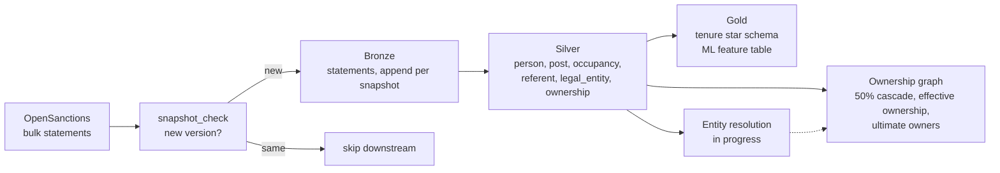
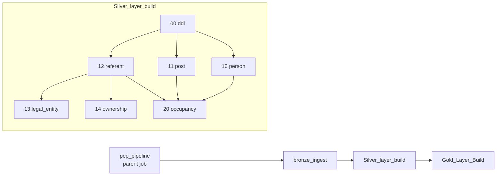

# pep-temporal-lakehouse

**Who really owns this company, and is the politician still in office?**
A lakehouse on Databricks that turns the OpenSanctions bulk data into answers to those two questions, using Spark SQL, Delta Lake and Databricks Jobs.

A sanctioned person rarely holds assets in their own name. They hold them through companies, and those companies own other companies. A politician's record often says when a term started but not whether it ended. Both problems look simple and are not. This project works through them on real, messy data and measures the results.

## How to read this

- **Not technical?** Read [What this project answers](#what-this-project-answers), [Headline results](#headline-results), the small example under [the 50% rule](#ownership-graph-part-1-the-50-rule), and [Limits](#limits). Every section also opens with a line in plain words.
- **Engineer?** The design decisions, SQL and checks are in each section, and the mistakes are in [What went wrong and what it taught](#what-went-wrong-and-what-it-taught).

## Key terms

| Term | Meaning |
|---|---|
| Sanctions list | A government's public list of people and companies that others are barred from doing business with |
| Listed | Named on a sanctions list |
| Blocked | Not named on any list, but treated as sanctioned because of who owns it |
| PEP | Politically exposed person: someone holding a public office, and so a higher risk for bribery and money laundering checks |
| Snapshot | One dated copy of the whole dataset. OpenSanctions publishes a new one regularly |
| Bronze, Silver, Gold | Three stages of the same data: raw copy, cleaned tables, tables ready for reports |
| Ownership chain | A owns B, B owns C, and so on. Each step is one layer |
| Entity resolution | Working out which records describe the same real-world company |

## Contents

1. [What this project answers](#what-this-project-answers)
2. [Headline results](#headline-results)
3. [Architecture](#architecture)
4. [The data](#the-data)
5. [Bronze: snapshot-aware ingestion](#bronze-snapshot-aware-ingestion)
6. [Silver: from statements to tables](#silver-from-statements-to-tables)
7. [Gold: tenure star schema](#gold-tenure-star-schema)
8. [Orchestration](#orchestration)
9. [Ownership graph, part 1: the 50% rule](#ownership-graph-part-1-the-50-rule)
10. [Ownership graph, part 2: checking against OpenSanctions](#ownership-graph-part-2-checking-against-opensanctions)
11. [Ownership graph, part 3: effective ownership](#ownership-graph-part-3-effective-ownership)
12. [Ownership graph, part 4: ultimate owners](#ownership-graph-part-4-ultimate-owners)
13. [Entity resolution (in progress)](#entity-resolution-in-progress)
14. [What went wrong and what it taught](#what-went-wrong-and-what-it-taught)
15. [Limits](#limits)
16. [Status and roadmap](#status-and-roadmap)
17. [Repository layout](#repository-layout)
18. [Running it](#running-it)
19. [Author](#author)
20. [Data and licence](#data-and-licence)

## What this project answers

**Goal 1: is this person still in office?**
OpenSanctions lists politically exposed persons (PEPs) and the positions they hold. Many position records carry no status and no end date, so "still in office" cannot be read off the data. The pipeline gives every record a verdict: confirmed current, confirmed ended, ended because the record disappeared from the source, or unverifiable.

**Goal 2: who really owns this company?**
Ownership records say "A owns 60% of B". Chains of them reach many layers deep. The pipeline walks those chains to find companies blocked under the US 50% rule, the effective share each owner really holds, and the party at the top of each chain.

## Headline results

All numbers are from the OpenSanctions snapshot of 30 October 2026.

| Finding | Number |
|---|---|
| Companies blocked under the 50% rule without being on any sanctions list | 11,091 |
| Of those, blocked only through layers of other companies | 3,010 (27%) |
| Deepest blocking chain | 6 layers |
| OpenSanctions' own "controlled by a sanctioned party" flags reproduced independently | 29,083 of 29,150 (99.8%) |
| Ownership paths enumerated for effective ownership | 256,902, up to 18 links long |
| Companies whose recorded owners add up to more than 100% | 104, all flagged |
| Ultimate owners identified | 24,489 across 91,702 owner-company pairs |
| Ownership references that resolve to a known entity | 100% of 206,390 |

## Architecture



| Layer | Schema | Holds |
|---|---|---|
| Landing | `pep_dev.raw` | The raw statements file in a Unity Catalog Volume |
| Bronze | `pep_dev.bronze` | Statements as delivered, one copy per snapshot, plus a version control table |
| Silver | `pep_dev.silver` | One row per real-world thing: people, positions, companies, ownership links |
| Gold | `pep_dev.gold` | Star schema for BI and a feature table for ML |
| Scratch | `pep_dev.eval` | Graph traversal results, checks and entity resolution work |

**Stack:** Databricks Free Edition (serverless), Unity Catalog, Delta Lake, Spark SQL for all transformations, short Python loops only where SQL needs repeating, Databricks Jobs for orchestration, DBML for schema design. Lakeflow / DLT is not used, on purpose: every step is plain SQL that can be read and rerun by hand.

## The data

[OpenSanctions](https://www.opensanctions.org) combines sanctions lists, company registers and PEP sources from many countries. It publishes them in the FollowTheMoney model as **statements**: one row per fact.

| entity_id | schema | prop | value | dataset |
|---|---|---|---|---|
| abc-1 | Company | name | Alpha LLC | some_register |
| abc-1 | Company | jurisdiction | ru | some_register |
| own-9 | Ownership | owner | per-4 | some_register |
| own-9 | Ownership | asset | abc-1 | some_register |
| own-9 | Ownership | percentage | 60 | some_register |

This shape is flexible but hard to query. A company is not a row; it is a handful of rows that share an ID. A relationship (who owns what, who holds which office) is its own entity that points at two others. Three more things make it harder:

- **Two ID systems.** OpenSanctions has already merged records it believes are the same real-world thing, and gives the merged group a canonical ID. Some references use source IDs, others use canonical IDs.
- **Mixed provenance.** About 19% of statements are not original source assertions. They are derived or enriched, and some are generated by a language model. The `origin` column records this.
- **Values are text.** Dates, percentages and countries all arrive as strings in whatever form the source used.

## Bronze: snapshot-aware ingestion

**In plain words:** download the data only when there is a new version, keep every version, and never trust a load without checking it.

OpenSanctions republishes its data regularly. Each publication is a snapshot with a version string such as `20261030005356-xkx`.

**How a run decides whether to load:**

1. `snapshot_check` reads the OpenSanctions index API and parses the latest version out of the statements URL (the API does not publish it as a plain field).
2. It compares that version with `bronze.snapshot_version_control`.
3. It passes the result on as job task values. An If/Else task then either runs ingestion or **skips** it. Skipped, not failed: a run with nothing new still finishes green.

New snapshots are appended to `bronze.statements` with a `_snapshot_version` column. Nothing is overwritten, so earlier snapshots stay available. That history is what later lets the pipeline notice a record that has disappeared.

**The check that caught a broken parse.** The statements file is about 9.4 GB of CSV with line breaks inside quoted fields. Spark's standard corruption check (PERMISSIVE mode, count the corrupt-record column) reported zero bad rows while the parse was badly wrong. Comparing the raw line count with the parsed row count is what exposed it. The lesson, used throughout the project: verify with a number from outside the tool being tested.

## Silver: from statements to tables

**In plain words:** the raw data is millions of single facts. This stage assembles them into clean tables, one row per person, company or ownership link, and records where each row came from.

Silver turns statements into one row per real-world thing. Schemas were designed in DBML and each decision was checked against profiling queries before any table was built.

| Table | Grain | Notes |
|---|---|---|
| `silver.referent` | One row per source record | Maps every source ID to its canonical ID and record type. The translation layer everything else joins through. 4.5M rows |
| `silver.person` | One row per person | Names, birth and death dates, PEP and sanction flags |
| `silver.post` | One row per position | Position name, country, topics |
| `silver.occupancy` | One row per person-in-position | Start and end dates, status |
| `silver.legal_entity` | One row per company or organization | Names, country, identifiers, sanction flag. 362K rows |
| `silver.ownership` | One row per ownership link | Owner, asset, percentage range, dates, current flag. 206K rows |

**Design decisions and why**

- **Pivot, not join.** Each table is built by grouping statements by entity and picking each column with a conditional aggregate (`MAX(CASE WHEN prop = 'name' ...)`, `collect_set(...) FILTER (...)`). One pass over Bronze per table.
- **Current state with history columns.** Silver holds one row per entity, not one per snapshot. Each row carries `_first_seen_snapshot` and `_last_seen_snapshot`. Loads use `MERGE` and never delete. A record whose last-seen snapshot is older than the newest one has disappeared from the source, and that disappearance is itself information: it becomes the "derived ended" verdict in Gold.
- **Four ID columns on relationships.** Every link keeps the reference as the source wrote it (`owner_ref`, `asset_ref`) next to the resolved ID (`owner_id`, `asset_id`). If a lookup fails, the evidence is still there instead of a bare NULL.
- **One table for all company types.** An ownership link can point at a Company, an Organization or a generic LegalEntity. One `legal_entity` table with an `entity_type` column means one join per hop in the graph. Three tables would mean three joins and a union per hop, and a missed type would silently cut chains short.
- **People kept out of the company table.** Some sources type individuals as legal entities. Groups containing any Person record are excluded. Check: Russian tax IDs split cleanly, 10 digits for the companies kept, 12 digits for the individuals removed.
- **Sanction flag from one topic only.** `is_sanctioned` means the entity is itself named on a sanctions list. OpenSanctions' derived tags ("linked to" or "controlled by" a sanctioned party) are not used as inputs, because the project computes those relationships itself and using them would be circular.
- **Constraints.** Primary and foreign keys are declared; allowed-value columns use `CHECK` constraints because Databricks has no ENUM type.

**Percentages are not numbers.** The percentage field needed ordered cleaning rules, found by profiling rather than from documentation:

| Case | Example | Handling |
|---|---|---|
| Plain number | `60` | cast |
| Percent sign | `60%` | strip the sign |
| Band | `75–100%` | split into low and high |
| Fraction (one source) | `0.5` meaning 50% | multiply by 100 |
| Zero or above 100 | `0`, `1000` | percentage set to NULL, link kept |

Each link ends up with `pct_min` and `pct_max`, so a band stays a band instead of becoming false precision. A single cast would have silently lost the bands and turned one source's 50% stakes into 0.5%.

**Checks on Silver**

- Every owner and asset reference resolves to a known entity: 0 dangling out of 206,390 links.
- Every company on either end of a link has a `legal_entity` row.
- Silver builds read under 1 GB of Bronze and skip about 97% of it, because the snapshot filter lets Delta skip older snapshots' files. The full Silver job runs in under two minutes.

## Gold: tenure star schema

**In plain words:** the final tables an analyst would open in a dashboard, where every politician's position has a clear answer to "still in office?".

Gold answers Goal 1 and is kept lean: only what BI (dashboards and reports) and ML (machine learning) need.

| Table | Purpose |
|---|---|
| `gold.dim_person` | One row per person with a surrogate key, PEP and sanction flags, number of positions |
| `gold.dim_post` | One row per position with a surrogate key |
| `gold.dim_date` | Calendar dimension |
| `gold.fact_occupancy_period` | One row per person-in-position, with date keys, raw dates and the tenure verdict |
| `gold.ml_tenure_features` | One row per occupancy with features and a label, ready for a model |

**The tenure verdict** turns "we don't know" into four explicit states:

| Verdict | Meaning |
|---|---|
| `confirmed_current` | The source says the person holds the position now |
| `confirmed_ended` | The source gives an end date or an ended status |
| `derived_ended` | The record was in an earlier snapshot and is gone from the latest one (needs at least two loaded snapshots) |
| `unverifiable` | No status, no end date, still present: the data cannot say |

The fact table keeps raw date strings next to date keys, because many source dates are partial (a year only) and forcing them into full dates would invent precision.

`ml_tenure_features` is feature preparation only. No model is trained in this repository.

## Orchestration



**In plain words:** the steps run automatically in the right order, steps that don't depend on each other run at the same time, and a run with no new data does nothing.

- One notebook per table, each a job task. Independent tables run in parallel; a table waits only for what it reads.
- A parent job chains three child jobs with Run Job tasks, so each layer can also be run alone.
- The snapshot gate sits in `bronze_ingest`. When nothing is new, downstream work is skipped.
- Graph traversal and entity resolution are kept off the daily path. They are heavier and Free Edition has a daily compute quota.

## Ownership graph, part 1: the 50% rule

### The rule in plain words

The US Treasury (OFAC) has a 50% rule. A company is treated as blocked if sanctioned owners hold 50% or more of it, added together, directly or through other companies. A company that becomes blocked this way then counts as a blocked owner itself.

So the question is: which companies are blocked by this rule even though no sanctions list names them?

### A small example

Ivan and Vega Corp are already on a sanctions list. Olga is not.

| Owner | Company | Share |
|---|---|---|
| Ivan | Alpha | 60% |
| Ivan | Beta | 30% |
| Vega Corp | Beta | 25% |
| Alpha | Gamma | 70% |
| Olga | Delta | 100% |

- **Round 1:** Alpha is blocked (Ivan holds 60%). Beta is blocked too: neither owner has 50% alone, but 30% + 25% = 55%.
- **Round 2:** Alpha is now blocked, so its 70% of Gamma counts. Gamma is blocked, even though no sanctioned party owns it directly.
- **Round 3:** nothing new, so it stops. Delta is never blocked, because Olga is not sanctioned.

Two things matter here. Shares from different blocked owners add up (Beta). And blocked status passes down in full (Gamma), because the rule does not multiply percentages along a chain. Multiplying would say Ivan holds only 42% of Gamma (60% x 70%) and miss it.

### How it works (for engineers)

Two tables drive the cascade:

- `eval.edges_current`: one row per current ownership link (owner, company, percentage). 109,513 links.
- `eval.blocked`: the companies and people treated as blocked so far. It starts with everyone already on a sanctions list (53,035 of them).

One round of the cascade is a single SQL statement:

```sql
INSERT INTO eval.blocked
SELECT e.asset_id, e.asset_type, :round
FROM eval.edges_current AS e
JOIN eval.blocked AS b ON e.owner_id = b.node_id
WHERE e.asset_id NOT IN (SELECT node_id FROM eval.blocked)
GROUP BY e.asset_id, e.asset_type
HAVING sum(e.pct_lo) >= 50
```

The join keeps only links whose owner is already blocked. Grouping by company adds up all of its blocked owners' shares. A short Python loop reruns the statement until a round adds nothing new. Each round is written to a Delta table, so Spark's query plan does not grow with every round. It always stops, because the blocked list only grows and a company already on it is never added again.

Choices made when preparing the links:

- Only current ownership counts. A stake that has ended cannot block a company today.
- Companies that appear to own themselves are removed.
- If the same owner and company pair is reported more than once, the larger percentage is used, so one stake is not counted twice.
- Links with no percentage are kept in the table but cannot count towards 50%.

### Results

| Round | Newly blocked companies |
|---|---|
| 1 | 8,081 |
| 2 | 2,211 |
| 3 | 623 |
| 4 | 152 |
| 5 | 23 |
| 6 | 1 |

- **11,091 companies** are blocked by the rule without being on any list.
- **3,010 of them** are only reachable through layers of companies, so a direct "who owns this?" lookup misses them.
- The longest chain is six layers deep.

These are lower bounds ("blocked for sure"). Running the same loop on the upper end of percentage ranges adds only 11 "possibly blocked" companies, so the bands barely matter.

## Ownership graph, part 2: checking against OpenSanctions

**In plain words:** I compared my results with the data publisher's own answer. They agree on 99.8%, and I looked into every case where they don't.

A result nobody can check is worth little. OpenSanctions publishes its own tag for companies controlled by a sanctioned party, at any percentage and any depth. That makes it an independent benchmark.

The same loop, with the 50% threshold replaced by "any link", gives every company connected to a listed party through current ownership.

| Group | Companies |
|---|---|
| Tagged by OpenSanctions and reached by this project | 29,083 (99.8%) |
| Tagged by them, not reached here | 67 |
| Reached here, not tagged by them | 13 |

**Every difference was traced to a specific cause or an open question:**

- **The 67** connect to a listed party only through ownership that has an end date. For 66 of them, the chain passes through a pair of companies that own each other. One possible explanation is that such a pair keeps each other tagged after the original link has ended. This was raised as [a question on the OpenSanctions forum](https://discuss.opensanctions.org/t/can-sanction-control-sustain-itself-through-ownership-loops/390). It is an open question, not a claimed bug.
- **The 13** are mining sites linked through permit records from one source, which OpenSanctions does not appear to pass the tag through.

**Controlled is not the same as blocked.** Of the 29,150 tagged companies, 11,091 (38%) meet the 50% rule on known percentages. The other 62% are connected below 50% or through links with no percentage. For a compliance team those are very different levels of concern, and the split is something the tag alone does not give.

**Time matters.** 31,062 entities are connected to a listed party through current ownership. Including ended ownership raises that to 61,356. About half of all connections are historical.

## Ownership graph, part 3: effective ownership

**In plain words:** how much of a company does someone really own once every layer is counted? Working that out exposed records that contradict each other.

The 50% rule passes status down in full. **Effective ownership** is the other calculation: how much of a company an owner really holds once every layer is multiplied through. If X owns 50% of A and A owns 40% of B, X effectively owns 20% of B. If X reaches B by two routes, the routes add up.

### How it works

Every path through the graph is written out, one layer per round:

```sql
INSERT INTO eval.paths
SELECT p.top_id, p.top_type, e.asset_id,
       p.share * e.share,                 -- multiply down the chain
       :r,
       array_append(p.path, e.asset_id)   -- remember the route
FROM eval.paths AS p
JOIN eval.edges_pct AS e ON p.asset_id = e.owner_id
WHERE p.depth = :r - 1
  AND NOT array_contains(p.path, e.asset_id)   -- never visit a company twice
```

- Each path carries the list of companies it has passed through. A path may not revisit a company, so ownership loops cannot run forever or inflate a share.
- The loop stops at the first round that adds no paths. A depth cap exists only as a safety net: the first run used a cap of 10 and was still adding thousands of paths when it hit it. A cap is not an end.
- Paths are then grouped by top owner and company, and the shares are summed.

Result: 256,902 paths. The longest chain with known percentages is 18 links.

### The check that fired

One check ran after every build: no owner can hold more than 100% of a company. It failed. Some owners came out at 200% and more.

Tracing one case showed why. Two sources described the same group differently:

- A company register recorded the real shareholdings: parent, then middle company, then subsidiary.
- GLEIF (the global legal entity identifier system) recorded the **accounting parent**: parent, straight to subsidiary, 100%.

Both are true, but they are different kinds of fact. One is a deed, the other is an organization chart. Adding them counts the same control twice.

**Fix:** GLEIF links are left out of effective ownership and kept for the 50% cascade and reachability, where a shortcut does no harm. Removing 200 such links removed about 24,700 false routes.

**What remained:** 104 companies whose owners still add up to more than 100%. Three causes turned up when cases were checked by hand:

| Cause | What it looks like |
|---|---|
| Duplicate records | The same owner appears under two IDs that were never merged, each holding 100% |
| Unclosed handover | A company changed hands, and the old owner's link was never ended |
| Shortcut inside one source | The ultimate controller is also recorded as a direct owner |

These are **flagged, not fixed**. A `has_conflict` column marks every owner-company pair whose route passes through one of the 104 companies (2,172 pairs). Guessing a correction would hide the problem; a flag lets the reader decide. Final check: every share above 100% beyond rounding is flagged, and none is unflagged.

### What effective ownership shows

| Layers between owner and company | Pairs where a listed owner still holds 50% or more |
|---|---|
| 1 | 67% |
| 2 | 43% |
| 3 | 29% |
| 4 | 16% |
| 5 | 8% |
| 6 | 1.3% |
| 7 and deeper | 0 |

Control thins out quickly as layers are added. This is why the 50% rule does not multiply: a rule based on effective share could be escaped by adding layers.

Deep chains are not suspicious by themselves. The longest fully owned chain in the data, 12 layers of 100% stakes, is an ordinary project-finance structure for a power plant.

## Ownership graph, part 4: ultimate owners

**In plain words:** follow every chain upward until there is nobody left above. That party is the ultimate owner.

An ultimate owner is the top of a chain: an owner that nobody else owns in the data. They are found by keeping the owners that never appear as an owned company in any current link (an anti-join).

| Type at the top | Ultimate owners |
|---|---|
| Person | 14,764 (60%) |
| Company | 8,428 |
| Organization and other | 1,297 |

- 24,489 ultimate owners across 91,702 owner-company pairs.
- Regulators draw the beneficial-owner line at 25%, but not in the same place. At "25% or more" a person tops the chain of 17,490 companies; at "more than 25%" it is 17,011. About 900 companies sit exactly on the line, so the choice is stated rather than assumed.
- Nine of the ten largest ultimate owners are state bodies. When a chain ends at a company instead of a person, it is usually the state, a widely held listed company, or simply the edge of the data. It is not evidence of hidden ownership.

## Entity resolution (in progress)

**In plain words:** the same company is often written several ways ("Romashka LLC", "ООО Ромашка"). Until those are recognized as one company, ownership chains break in the middle.

The same company can appear under several records that nobody has merged. The effective-ownership work found real examples: one owner under two IDs, each holding 100% of the same subsidiary. Entity resolution finds those duplicates.

**Design**

- Match at the level of source records, and ignore OpenSanctions' own grouping while matching. That grouping is held back as the answer key: 720,762 pairs of records known to be the same. This gives two real numbers instead of an impression: precision (of the matches I make, how many are right) and recall (of the true matches, how many I find).
- The work is pinned to one snapshot, so before and after comparisons use the same data.
- 498,022 company records; 45% carry at least one official ID. The rest can only be matched by name.

**Done so far: name cleaning**

Names arrive in Cyrillic, Latin, Chinese and other scripts, with every style of quote and punctuation.

| Stage | Example |
|---|---|
| Raw | ООО «Ромашка-Плюс» |
| Lowercase, punctuation handled | ооо ромашка плюс |
| Legal form removed | ромашка плюс |

- **Punctuation by Unicode category, not by list.** A hand-written list of characters kept missing some. The pattern `[\p{P}\p{S}]` covers every punctuation mark and symbol in any script.
- **Apostrophes and dots are deleted, everything else becomes a space.** An apostrophe sits inside a word (об'єднання), and dotted abbreviations should stay whole (s.a. becomes sa, not "s a").
- **Legal forms live in a table, not in the query.** `eval.ref_legal_forms` holds 133 forms across Russian, Ukrainian, transliterated, English and other jurisdictions. A view compiles them into two regular expressions, longest first, so "limited liability company" is removed whole instead of leaving "liability company" behind. Adding a form means adding a row.
- **Chinese and Japanese forms are handled separately.** Those languages have no spaces between words, so "match whole words only" never matches. They get their own pattern.
- **Checked with a word count.** Before: "ltd" 102K, "общество" 115K. After: gone from the top, and the most common words are ones that describe the business.

**Next:** transliteration so Cyrillic and Latin spellings compare, exact matches on official IDs, blocking to avoid comparing every pair, similarity scoring with an ID veto, grouping, then measurement against the answer key.

## What went wrong and what it taught

| Problem | How it was caught | Lesson |
|---|---|---|
| CSV parse broken while Spark reported zero corrupt rows | Raw line count did not match parsed row count | Check with a number from outside the tool |
| Four companies seemed unreachable by any path | Their rows had an older last-seen snapshot | A table that keeps history needs a "present today" filter for questions about today |
| Owners holding 200% of a company | A sanity check on the result: no share above 100% | Two sources can both be right and still not be addable |
| Path loop run twice doubled and tripled the path counts | Round totals no longer matched the first run | A loop that appends must reset its table first |
| Depth cap of 10 looked like the end of the data | The last round still added thousands of paths | Stop when a round adds nothing, not at a cap |
| A character list for punctuation kept missing characters | Counting leftover characters after cleaning | Describe the rule (a category), not the instances |
| Display names came out in unexpected languages | `MAX` on text sorts by character code, so some scripts always win | Choose display values on purpose |

## Limits

- **Coverage is uneven.** 78% of ownership records come from the Russian company register. Results describe Russian ownership first and are not a global picture.
- **Missing percentages.** About 35% of current ownership links carry no percentage, and links taken from sanctions lists carry none. Such links count for reachability but cannot count towards 50%.
- **"Blocked" means blocked on this data.** It is the rule applied to public records, not a legal determination.
- **Duplicates split chains.** Two unmerged records of one company look like two companies. That is what entity resolution is for.
- **People typed as companies.** A few sources list individuals and firms together. Those that cannot be told apart remain in the company table, marked by type.

## Status and roadmap

| Part | Status |
|---|---|
| Bronze ingestion with snapshot gate | Done |
| Silver: person, post, occupancy, referent, legal_entity, ownership | Done |
| Gold tenure star schema and ML feature table | Done |
| Job orchestration, Bronze to Gold | Done |
| 50% cascade and benchmark against OpenSanctions | Done |
| Effective ownership with conflict flags | Done |
| Ultimate owners | Done |
| Entity resolution | In progress (name cleaning done) |
| Measuring entity resolution: precision and recall | Planned |
| Rerun the graph on resolved entities and report what changed | Planned |
| Gold tables for ownership and sanctions exposure; link PEPs to companies they own | Planned |
| Silver quarantine routing and integrity checks | Deferred |

## Repository layout

```
bronze/     snapshot check and ingestion
silver/     00 ddl, 10 person, 11 post, 12 referent,
            13 legal_entity, 14 ownership, 20 occupancy
gold/       40 ddl, 41 dim_date, 42 dim_person, 43 dim_post,
            50 fact_occupancy_period, 60 ml_tenure_features
adhoc/      goal2_profiling
            goal2_phase2_cascade
            goal2_phase2b_effective_ownership
            goal2_phase2b_checks
            goal2_phase3_entity_resolution
```

## Running it

This is a Databricks project, not a packaged tool. To reproduce it: create a Unity Catalog catalog with the schemas listed under [Architecture](#architecture), import this repository as a Git folder, download the OpenSanctions statements file into a Volume, and run the `pep_pipeline` job. The notebooks under `adhoc/` are run by hand, in the order listed.

## Author

Zishan Shaikh, data engineer. [LinkedIn](https://www.linkedin.com/in/zishan-shaikh-zs) · [GitHub](https://github.com/zerry101)

Questions and corrections are welcome: open an issue or message me.

## Data and licence

Data from [OpenSanctions](https://www.opensanctions.org), licensed CC BY-NC 4.0 (free for non-commercial use). The raw data is not included in this repository. No individual or company is named in this document; examples use made-up names.
